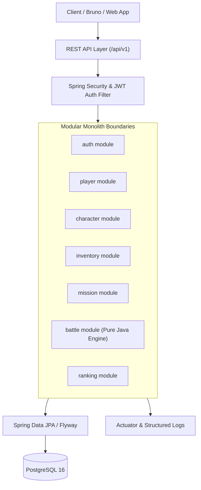

# RPG Arena — Open-Source Turn-Based RPG Backend

[](https://github.com/arthurtvrs10/rpg-arena-java/actions/workflows/ci.yml)
[](https://opensource.org/licenses/MIT)
[](https://www.oracle.com/java/technologies/javase/jdk21-archive-downloads.html)
[](https://spring.io/projects/spring-boot)

> **RPG Arena is an open-source turn-based RPG backend designed as a practical Java software engineering laboratory.**
>
> The project goes beyond basic CRUD operations by exploring domain modeling, state machines, transactions, idempotency, concurrent battle actions, authentication, authorization, PostgreSQL, automated testing, Docker, and continuous integration.

> [!IMPORTANT]
> **This project focuses on backend engineering. It is not a graphical game or game engine.**

🇧🇷 **Documentação em Português:** Para ler o plano mestre, referências de estudo e guias originais em português do Brasil, acesse [README.pt-BR.md](README.pt-BR.md) ou a pasta [docs/pt-BR/](docs/pt-BR/COMECE-AQUI.md).

---

## 1. Project Overview

RPG Arena is a robust backend system for a turn-based RPG where players register, create characters, manage inventories, embark on quests, fight in tactical turn-based combat, and compete on a public leaderboard.

The goal of this repository is to demonstrate real-world software engineering decisions, transactional boundaries, concurrency handling, and clean modular architecture in Java 21 and Spring Boot.

---

## 2. Current Status

| Phase | Sprint | Status | Description |
|---|---|---|---|
| **Sprint 1** | Sprint 1 — Product, Domain and Foundation | 🟡 **In Progress (DAY-01 Ready)** | Architecture definition, domain modeling, and technical baseline |
| **Sprint 2** | Sprint 2 — Security, Character and Inventory | ⚪ Planned | Authentication, JWT, ownership authorization, inventory transactions |
| **Sprint 3** | Sprint 3 — Missions, Combat and Concurrency | ⚪ Planned | Quest state machine, idempotent rewards, turn-based combat engine, optimistic locking |
| **Sprint 4** | Sprint 4 — Release and Portfolio | ⚪ Planned | Ranking projection, OWASP hardening, Testcontainers, CI/CD, and release 1.0.0 |

*Current release:* `v0.1.0-dev` (Repository Foundation established; game features under active development).

---

## 3. Educational Objectives

This laboratory is designed to practice and demonstrate:
- **Domain Modeling & Invariants:** Encapsulating combat calculations and character progression in pure Java domain entities independent of web frameworks.
- **Security & Authorization:** Preventing Broken Object-Level Authorization (BOLA/IDOR) by resolving identity strictly from authenticated JWT tokens rather than untrusted client inputs.
- **Transactional Consistency:** Enforcing atomic operations across inventory equipment swaps and mission rewards.
- **Concurrency & Idempotency:** Implementing optimistic locking (`@Version`) for simultaneous battle turns and deduplication keys for repeatable actions.
- **Automated Testing:** Unit testing domain logic, testing integration boundaries with PostgreSQL via Testcontainers, and maintaining contract testing via Bruno.
- **DevOps & Delivery:** Containerization with Docker Compose, reproducible migrations with Flyway, and automated CI pipelines with GitHub Actions.

---

## 4. Planned vs. Completed Features

### Completed (Foundation)
- [x] Repository architecture & open-source governance setup
- [x] 30-Day sprint roadmap and 24 structured engineering tasks
- [x] Architecture Decision Records (ADRs) template and domain specifications
- [x] GitHub workflows and Dependabot configuration

### Planned (Under Active Development)
- [ ] **Identity & Auth:** Player registration, login, password hashing (BCrypt), JWT issuance and validation.
- [ ] **Player & Character:** Character creation (up to 3 per player), classes, attributes, XP leveling formulas.
- [ ] **Inventory & Equipment:** Slot-based equipment system (Weapon, Armor, Accessory) with atomic transactions.
- [ ] **Missions:** Finite state machine (`DRAFT`, `ACTIVE`, `COMPLETED`, `FAILED`) with single-claim idempotent rewards.
- [ ] **Combat Engine:** Deterministic turn-based combat, action points, skill cooldowns, optimistic concurrency.
- [ ] **Ranking:** Paginated leaderboard projection sorted deterministically by victories and level.
- [ ] **Observability & Docs:** OpenAPI (Swagger UI), Problem Details (RFC 7807), structured logging, and Actuator metrics.

---

## 5. Technology Stack

- **Language:** Java 21 (LTS)
- **Framework:** Spring Boot 3.x (Spring Web, Spring Security, Spring Data JPA, Spring Validation)
- **Database:** PostgreSQL 16
- **Database Migrations:** Flyway
- **Testing:** JUnit 5, Mockito, AssertJ, Testcontainers
- **API Client & Contracts:** Bruno Collection (`/bruno`)
- **Containerization:** Docker & Docker Compose
- **CI/CD:** GitHub Actions
- **API Documentation:** OpenAPI 3.0 / Springdoc Swagger

---

## 6. Modular Monolith Architecture

RPG Arena is designed as a **Modular Monolith** organized by feature/domain module. Each module encapsulates its API controllers, application use cases, domain model, and persistence infrastructure.



---

## 7. Directory Structure

```text
rpg-arena-java/
├── .github/
│   ├── ISSUE_TEMPLATE/       # GitHub issue forms (bug, feature, docs)
│   ├── workflows/            # GitHub Actions CI workflow
│   ├── CODEOWNERS            # Repository ownership rules
│   ├── dependabot.yml        # Weekly dependency update automation
│   └── PULL_REQUEST_TEMPLATE.md
├── docs/
│   ├── adr/                  # Architecture Decision Records
│   ├── en/                   # Technical documentation in English
│   └── pt-BR/                # Original 30-day study plan, references & guides
├── src/
│   ├── main/
│   │   ├── java/com/rpgarena/
│   │   │   ├── auth/         # Authentication & JWT security
│   │   │   ├── player/       # Player account management
│   │   │   ├── character/    # Character aggregate & progression
│   │   │   ├── inventory/    # Item catalog, inventory & slots
│   │   │   ├── mission/      # Mission state machine & rewards
│   │   │   ├── battle/       # Combat engine & turn processing
│   │   │   ├── ranking/      # Leaderboard projections
│   │   │   └── shared/       # Common kernel, exceptions, utility classes
│   │   └── resources/
│   │       ├── db/migration/ # Flyway SQL migrations
│   │       └── application.yml
│   └── test/                 # Unit, slice, and Testcontainers integration tests
├── bruno/                    # Executable Bruno API collection
├── docker-compose.yml        # Local PostgreSQL & container setup
├── pom.xml                   # Maven build descriptor
├── CHANGELOG.md
├── CODE_OF_CONDUCT.md
├── CONTRIBUTING.md
├── LICENSE
├── README.md                 # English documentation (this file)
└── README.pt-BR.md           # Portuguese documentation
```

---

## 8. Core Domain & Business Rules

1. **Account Limits:** Each active player account can own at most 3 characters.
2. **Character Uniqueness:** Character names are case-insensitively unique across the entire game.
3. **Ownership Isolation:** Players may only query or modify characters, inventories, and active sessions they own.
4. **Equipment Consistency:** Equipping an item requires the item to exist in the character's inventory; equipping atomically replaces any item currently occupying that slot.
5. **Mission State Machine:** Missions transition strictly across `DRAFT` → `ACTIVE` → `COMPLETED` / `FAILED`. Terminal states cannot be reopened.
6. **Idempotent Rewards:** Completing a mission grants rewards (XP, items, gold) exactly once; duplicate completion requests return the existing reward without double allocation.
7. **Deterministic Combat:** Combat damage calculation and skill effects are isolated in framework-agnostic pure Java classes.
8. **Turn-Based Concurrency:** Only the participant assigned to the current active turn may issue an action. Concurrent updates use optimistic locking (`version` column).
9. **Ranking Projections:** The leaderboard is a read-optimized projection updated only after battles are officially marked `FINISHED`.

---

## 9. Local Development & Quick Start

### Prerequisites
- **Java 21** (JDK)
- **Docker** & **Docker Compose**
- **Git**
- **Bruno** (optional, for running the API collection)

### Step-by-Step Execution

1. **Clone the repository:**
   ```bash
   git clone https://github.com/arthurtvrs10/rpg-arena-java.git
   cd rpg-arena-java
   ```

2. **Configure Environment Variables:**
   Copy the example environment file:
   ```bash
   cp .env.example .env
   ```

3. **Start PostgreSQL via Docker Compose:**
   ```bash
   docker compose up -d postgres
   ```

4. **Run Database Migrations and Tests:**
   ```bash
   ./mvnw clean verify
   ```

5. **Start the Application:**
   ```bash
   ./mvnw spring-boot:run
   ```

6. **Verify Healthcheck:**
   ```bash
   curl http://localhost:8080/actuator/health
   ```

To run both PostgreSQL and the application fully in Docker:
```bash
docker compose up --build
```

---

## 10. Environment Variables & Configuration

The application uses externalized configuration. No secret values are hardcoded in source files.

| Variable | Required | Default Value | Description |
|---|:---:|---|---|
| `DB_URL` | **Yes** | `jdbc:postgresql://localhost:5432/rpg_arena` | PostgreSQL JDBC connection URL |
| `DB_USERNAME` | **Yes** | `rpg_user` | Database user name |
| `DB_PASSWORD` | **Yes** | `rpg_password` | Database password |
| `JWT_SECRET` | **Yes** | — *(Generate a 256-bit secret)* | Secret key for signing JWT tokens |
| `JWT_EXPIRATION_MS`| No | `86400000` (24 hours) | Token expiration duration in milliseconds |
| `SERVER_PORT` | No | `8080` | HTTP web server port |
| `SPRING_PROFILES_ACTIVE` | No | `dev` | Active Spring profile (`dev`, `test`, `prod`) |

---

## 11. Database Migrations (Flyway)

Database schema evolution is managed entirely through versioned Flyway SQL scripts located in `src/main/resources/db/migration/`:

- `V1__create_player_and_character_tables.sql`
- `V2__create_inventory_and_item_tables.sql`
- `V3__create_mission_and_attempt_tables.sql`
- `V4__create_battle_and_action_tables.sql`
- `V5__create_ranking_and_indexes.sql`

Never modify an existing, committed migration. Always add a new incremental migration file.

---

## 12. Testing Strategy

The test suite follows a multi-tier testing pyramid:

```bash
# Run unit tests only
./mvnw test

# Run all unit, slice, and Testcontainers integration tests
./mvnw verify
```

- **Unit Tests (`*Test.java`):** Pure Java tests validating character progression, combat calculations, and state machine transitions without Spring context overhead.
- **Slice Tests (`*ControllerTest.java`, `*RepositoryTest.java`):** `@WebMvcTest` and `@DataJpaTest` checking HTTP contracts, validation annotations, and SQL queries.
- **Integration Tests (`*IT.java`):** Full end-to-end tests running against an actual PostgreSQL container instance managed by **Testcontainers**.
- **Security Tests:** Dedicated tests ensuring Cross-Player Access Rejection (BOLA/IDOR protection).

---

## 13. Bruno API Collection

An executable API collection is maintained in the [`/bruno`](bruno/) folder. You can import this folder into the [Bruno API Client](https://www.usebruno.com/) to execute the demonstration flow:

1. Register new player account (`POST /api/v1/auth/register`)
2. Authenticate and capture JWT (`POST /api/v1/auth/login`)
3. Create character (`POST /api/v1/characters`)
4. Equip starter weapon (`PUT /api/v1/characters/:id/equipment/WEAPON`)
5. Start and complete quest (`POST /api/v1/characters/:id/missions/:missionId/attempts`)
6. Initiate PvE combat (`POST /api/v1/characters/:id/battles`)
7. Execute turn actions until resolution (`POST /api/v1/battles/:id/actions`)
8. View global ranking (`GET /api/v1/rankings`)
9. Verify cross-player authorization rejection (`GET /api/v1/characters/:otherPlayerId` -> `403 Forbidden`)

---

## 14. Docker Support

A multi-stage `Dockerfile` and `docker-compose.yml` provide a reproducible environment:

```yaml
services:
  postgres:
    image: postgres:16-alpine
    environment:
      POSTGRES_DB: rpg_arena
      POSTGRES_USER: rpg_user
      POSTGRES_PASSWORD: rpg_password
    ports:
      - "5432:5432"

  app:
    build: .
    ports:
      - "8080:8080"
    environment:
      DB_URL: jdbc:postgresql://postgres:5432/rpg_arena
      DB_USERNAME: rpg_user
      DB_PASSWORD: rpg_password
      JWT_SECRET: ${JWT_SECRET}
    depends_on:
      postgres:
        condition: service_healthy
```

---

## 15. Continuous Integration (CI)

Every push and pull request to `main` triggers our GitHub Actions CI pipeline ([`.github/workflows/ci.yml`](.github/workflows/ci.yml)):
- Checks out code on Ubuntu LTS.
- Configures JDK 21 with Temurin distribution.
- Caches Maven dependencies for fast builds.
- Executes `./mvnw clean verify`.
- Verifies code style, test execution, and packaging.

---

## 16. Technical Documentation

- **[Product Scope & Requirements](docs/en/PRODUCT-SCOPE.md)**: Full requirements, users, acceptance criteria, and out-of-scope definitions.
- **[Architecture & Design Guide](docs/en/ARCHITECTURE.md)**: Modular structure, transaction boundaries, and state machines.
- **[Architecture Decision Records (ADRs)](docs/adr/)**: Documented technical decisions and trade-offs.
- **[Contributing Guide](CONTRIBUTING.md)**: Contribution standards, code style, and branch conventions.
- **[Portuguese Study Material & 30-Day Plan](docs/pt-BR/COMECE-AQUI.md)**: Complete Brazilian Portuguese learning track and task guides.

---

## 17. Development Roadmap

- **Sprint 1 (Days 01–06):** Product vision, domain invariants, modular architecture, Flyway setup, pure Java progression.
- **Sprint 2 (Days 07–12):** Threat model, Spring Security + JWT, ownership isolation, character & inventory transactions.
- **Sprint 3 (Days 13–18):** Mission state machine, idempotent reward engine, turn-based combat engine, optimistic locking.
- **Sprint 4 (Days 19–24):** Paginated ranking projection, OWASP hardening, OpenAPI contract, Testcontainers CI, 1.0.0 Release.
- **Post-MVP (v1.1+):** Battle replay logs, domain event outbox pattern, asynchronous PvP matchmaking.

---

## 18. How to Contribute

Contributions are welcome! Please follow these steps:

1. Check open issues in the [GitHub Project Board](https://github.com/arthurtvrs10/rpg-arena-java/issues).
2. Create a feature branch following semantic naming: `feat/character-leveling` or `fix/jwt-expiration-check`.
3. Ensure all tests pass (`./mvnw clean verify`).
4. Submit a Pull Request targeting `main` using the provided [PR Template](.github/PULL_REQUEST_TEMPLATE.md).

For detailed rules, read [CONTRIBUTING.md](CONTRIBUTING.md) and [CODE_OF_CONDUCT.md](CODE_OF_CONDUCT.md).

---

## 19. Security Policy

If you discover a security vulnerability, please report it privately via GitHub's [Private Vulnerability Reporting](https://github.com/arthurtvrs10/rpg-arena-java/security/advisories/new). Read [SECURITY.md](SECURITY.md) for full instructions.

---

## 20. License

This project is open-source software licensed under the [MIT License](LICENSE).

---

## 21. Author

Developed and maintained by **Arthur Tavares**:
- **GitHub:** [@arthurtvrs10](https://github.com/arthurtvrs10)
- **Location:** Brasília, DF - Brazil
- **Focus:** Backend Software Engineering with Java & Spring Boot

---

## 22. Brazilian Portuguese Documentation

Para desenvolvedores e estudantes de língua portuguesa, todo o material de estudo original, índice de tarefas e documentos conceituais estão preservados:

- [Visão Geral em Português (README.pt-BR.md)](README.pt-BR.md)
- [Comece Aqui](docs/pt-BR/COMECE-AQUI.md)
- [Plano Mestre de 30 Dias](docs/pt-BR/PLANO-MESTRE-30-DIAS.md)
- [Índice das 24 Tarefas Diárias](docs/pt-BR/INDICE-DAS-TAREFAS.md)
- [Mapa de Competências e Evidências](docs/pt-BR/MAPA-DE-COMPETENCIAS.md)
- [Documentos de Referência Técnica](docs/pt-BR/reference/)
