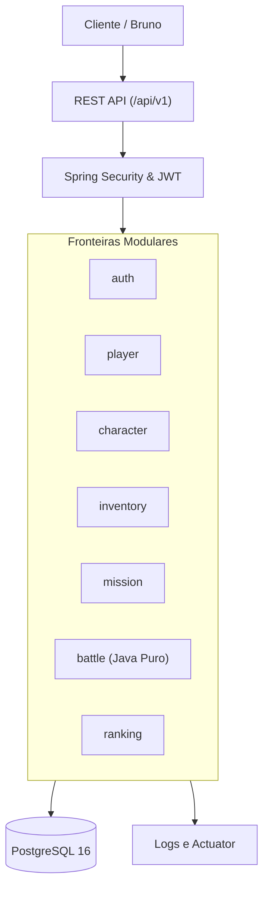

# RPG Arena API — Documentação em Português

[](https://github.com/arthurtvrs10/rpg-arena-java/actions/workflows/ci.yml)
[](LICENSE)
[](https://www.oracle.com/java/technologies/javase/jdk21-archive-downloads.html)
[](https://spring.io/projects/spring-boot)

> **O RPG Arena é um backend open-source de RPG por turnos projetado como um laboratório prático de engenharia de software com Java.**
>
> O projeto vai além do CRUD básico explorando modelagem de domínio, máquinas de estado, transações, idempotência, ações concorrentes em batalha, autenticação, autorização, PostgreSQL, testes automatizados, Docker e integração contínua.

> [!IMPORTANT]
> **Este projeto tem foco exclusivo em engenharia backend. Não é um jogo gráfico nem uma game engine.**

🇬🇧 **English Documentation:** For the primary English README and project specifications, see [README.md](README.md).

---

## 1. O que o sistema faz

- Cadastro e autenticação segura de jogadores com JWT;
- Criação e progressão de personagens com regras puras de atributos e XP;
- Inventário com equipamento atômico por slots;
- Missões orientadas por máquina de estados com recompensas idempotentes;
- Batalhas táticas PvE por turnos;
- Controle de concorrência nas ações de combate com bloqueio otimista (`@Version`);
- Ranking paginado apoiado por índices e consultas otimizadas;
- Administração de catálogos de itens e missões;
- Documentação OpenAPI/Swagger, healthcheck via Actuator e logs estruturados.

---

## 2. Stack Tecnológica

- **Linguagem:** Java 21 (LTS)
- **Framework:** Spring Boot 3.x (Spring Web, Spring Security, Spring Data JPA, Spring Validation)
- **Banco de Dados:** PostgreSQL 16
- **Versionamento de Banco:** Flyway
- **Testes:** JUnit 5, Mockito, AssertJ, Testcontainers
- **Cliente HTTP / Testes de Contrato:** Bruno
- **Containers:** Docker e Docker Compose
- **Integração Contínua:** GitHub Actions
- **Contrato de API:** OpenAPI 3.0

---

## 3. Arquitetura

O projeto adota a arquitetura de **Monólito Modular** com organização por funcionalidade. Cada módulo encapsula sua API, aplicação, domínio e infraestrutura sem criar microsserviços prematuros.



---

## 4. Decisões de Projeto

- **Identidade segura:** A identidade do jogador é obtida estritamente do token JWT, nunca confiada a identificadores enviados no corpo ou na URL pelo cliente (proteção contra BOLA/IDOR).
- **Domínio puro:** As regras de combate e cálculo de evolução são modeladas em classes Java puras, sem acoplamento a anotações ou dependências do Spring.
- **Consistência transacional:** Missão e recompensa compartilham a mesma transação no banco de dados.
- **Idempotência:** Ações e recompensas repetidas utilizam chave de idempotência para evitar efeitos duplicados.
- **Concorrência segura:** Batalhas utilizam controle de versão otimista (`@Version`).
- **Ranking desacoplado:** O ranking é uma projeção de leitura atualizada apenas após a finalização da batalha.
- **Testes com banco real:** Testcontainers com PostgreSQL real é utilizado para validar persistência crítica.

As decisões detalhadas estão registradas em [docs/adr/](docs/adr/).

---

## 5. Pré-requisitos

- Java 21 (JDK);
- Docker e Docker Compose;
- Git;
- Bruno (opcional, para execução da coleção de endpoints).

---

## 6. Execução Local

1. **Clone o repositório:**
   ```bash
   git clone https://github.com/arthurtvrs10/rpg-arena-java.git
   cd rpg-arena-java
   ```

2. **Configure o arquivo de ambiente:**
   ```bash
   cp .env.example .env
   ```

3. **Suba o banco de dados PostgreSQL:**
   ```bash
   docker compose up -d postgres
   ```

4. **Execute as migrations e a suíte de testes:**
   ```bash
   ./mvnw clean verify
   ```

5. **Inicie a aplicação Spring Boot:**
   ```bash
   ./mvnw spring-boot:run
   ```

6. **Verifique o healthcheck:**
   ```bash
   curl http://localhost:8080/actuator/health
   ```

Para executar tudo em containers Docker:
```bash
docker compose up --build
```

---

## 7. Configuração de Variáveis de Ambiente

| Variável | Obrigatória | Padrão | Descrição |
|---|:---:|---|---|
| `DB_URL` | **Sim** | `jdbc:postgresql://localhost:5432/rpg_arena` | URL JDBC do PostgreSQL |
| `DB_USERNAME` | **Sim** | `rpg_user` | Usuário do banco |
| `DB_PASSWORD` | **Sim** | `rpg_password` | Senha do banco |
| `JWT_SECRET` | **Sim** | — *(Chave de 256 bits)* | Segredo para assinatura de tokens JWT |
| `JWT_EXPIRATION_MS` | Não | `86400000` (24h) | Validade do token em milissegundos |
| `SERVER_PORT` | Não | `8080` | Porta HTTP da aplicação |
| `SPRING_PROFILES_ACTIVE` | Não | `dev` | Perfil ativo do Spring |

Nenhum segredo real deve ser versionado no repositório.

---

## 8. Estratégia de Testes

```bash
# Executar apenas testes unitários
./mvnw test

# Executar testes unitários, testes de slice e testes de integração com Testcontainers
./mvnw verify
```

- **Testes Unitários:** Regras de negócio, cálculos de dano e máquina de estados em Java puro;
- **Testes de Aplicação e Slice:** `@WebMvcTest` e `@DataJpaTest` para validar contratos HTTP e repositórios;
- **Testes de Integração:** Testes ponta a ponta com container PostgreSQL real gerenciado pelo Testcontainers;
- **Testes de Segurança:** Validação de acesso cruzado (rejeição de acessos entre jogadores diferentes);
- **Coleção Bruno:** Cenários de fluxo real na pasta `bruno/`.

---

## 9. Fluxo Demonstrável

1. Cadastrar jogador (`POST /api/v1/auth/register`);
2. Autenticar e obter JWT (`POST /api/v1/auth/login`);
3. Criar personagem (`POST /api/v1/characters`);
4. Equipar item do inventário (`PUT /api/v1/characters/{id}/equipment/{slot}`);
5. Iniciar e concluir missão (`POST /api/v1/characters/{id}/missions/{missionId}/attempts`);
6. Verificar concessão idempotente de recompensa;
7. Iniciar batalha PvE (`POST /api/v1/characters/{id}/battles`);
8. Executar ações por turno até o encerramento (`POST /api/v1/battles/{id}/actions`);
9. Consultar ranking paginado (`GET /api/v1/rankings`);
10. Tentar acessar personagem de outro jogador e receber `403 Forbidden`.

---

## 10. Documentação Completa do Plano de 30 Dias

Toda a trilha de estudo e especificações em português:

- [Comece Aqui](docs/pt-BR/COMECE-AQUI.md)
- [Plano Mestre de 30 Dias](docs/pt-BR/PLANO-MESTRE-30-DIAS.md)
- [Escopo do Produto](docs/pt-BR/PRODUCT-SCOPE.md)
- [Índice das 24 Tarefas Diárias](docs/pt-BR/INDICE-DAS-TAREFAS.md)
- [Mapa de Competências e Evidências](docs/pt-BR/MAPA-DE-COMPETENCIAS.md)
- [Documentos de Referência](docs/pt-BR/reference/)
- [Plano de Estudo por Sprint](docs/pt-BR/study-plan/)
- [Templates](docs/pt-BR/templates/)

---

## 11. Autor

Projeto desenvolvido por **Arthur Tavares**:
- **GitHub:** [@arthurtvrs10](https://github.com/arthurtvrs10)
- **Localização:** Brasília, DF - Brasil
- **Perfil:** Engenharia de Software Backend com foco em Java e Spring Boot
