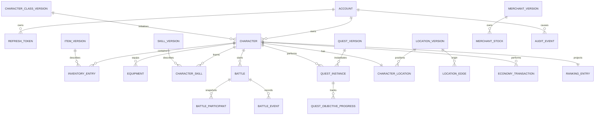

# Modelo e dicionário de dados

## Convenções

- PostgreSQL; nomes `snake_case`.
- PK UUID gerada pela aplicação.
- Instantes `timestamptz` em UTC.
- `created_at` obrigatório; `updated_at` em agregados mutáveis.
- `version bigint not null` para optimistic locking.
- Enums persistidos como `varchar` com check constraint ou tabela de referência; nunca ordinal.
- Ouro/quantidades em `bigint`/`integer`; sem `double`.
- Definições publicadas são imutáveis; instâncias referenciam `version_id`.
- Exclusão física só para rascunho sem referência. Conta/personagem/conteúdo publicado usa estado.

## Visão relacional

## Identidade

### `account`

| Coluna | Tipo | Regra |
|---|---|---|
| id | uuid | PK |
| email | varchar(254) | not null; valor normalizado |
| password_hash | varchar(255) | not null |
| display_name | varchar(32) | not null |
| role | varchar(20) | `PLAYER` ou `ADMIN` |
| status | varchar(20) | `ACTIVE` ou `BLOCKED` |
| blocked_reason | varchar(200) | null se ativa |
| created_at | timestamptz | not null |
| updated_at | timestamptz | not null |
| last_login_at | timestamptz | nullable |
| version | bigint | optimistic lock |

Índices: unique `lower(email)`; índice por `status`. Check garante coerência entre status e motivo.

### `refresh_token`

| Coluna | Tipo | Regra |
|---|---|---|
| id | uuid | PK |
| account_id | uuid | FK account, not null |
| family_id | uuid | not null |
| token_hash | varchar(128) | unique, not null |
| issued_at/expires_at | timestamptz | not null |
| used_at/revoked_at | timestamptz | nullable |
| replaced_by_id | uuid | FK self, nullable |
| revoke_reason | varchar(80) | nullable |

Índices: account/family, expires_at. Nunca persistir token puro.

## Conteúdo versionado

Cada catálogo usa duas tabelas: uma definição estável (`*_definition`) com `id`, `code`, `created_at`; e uma versão imutável (`*_version`) com `definition_id`, `version_number`, `status`, payload tipado, autoria e timestamps. Unique `(definition_id, version_number)`. Somente uma versão `PUBLISHED` atual por definição, garantida por índice parcial ou transação/constraint adequada.

Estados: `DRAFT`, `PUBLISHED`, `ARCHIVED`. Rascunho editável; publicado imutável; arquivado histórico.

### `character_class_definition` / `character_class_version`

Campos da versão: `name`, `description`, `base_health`, `base_mana`, `base_attack`, `base_defense`, `base_speed`, crescimentos por nível, `initial_location_version_id`, `initial_gold`, autoria e estado. Todos os atributos positivos, exceto defesa/mana que aceitam zero.

### `skill_definition` / `skill_version`

Campos: `name`, `description`, `class_definition_id`, `required_level`, `skill_type`, `target_type`, `mana_cost`, `cooldown_turns`, `power`, `effect_code`, `effect_duration`. Checks impedem custo/cooldown/poder negativos.

### `item_definition` / `item_version`

Campos: `name`, `description`, `item_type` (`EQUIPMENT`, `CONSUMABLE`, `QUEST`), `rarity`, `equipment_slot`, `stackable`, `max_stack`, `sellable`, `base_buy_price`, `base_sell_price`, bônus de stats e efeito consumível. Checks ligam slot a equipamento, maxStack e preços.

### `enemy_definition` / `enemy_version`

Campos: nome, nível mínimo/máximo, boss, stats, XP, política de ação, loot table version e habilidades versionadas.

### `quest_definition` / `quest_version`

Campos: título, resumo, nível mínimo/máximo, classe opcional, local inicial, abandonável, missão anterior, objetivos e grafo narrativo. Objetivos/nós podem usar tabelas filhas ou JSONB validado; baseline escolhe tabelas filhas para objetivos e JSONB validado para condições/efeitos pequenos.

### `region_definition`/`region_version`, `location_definition`/`location_version`

Região: nome e descrição. Local: região, nome, descrição, `is_safe`, restrições e visibilidade. Conexões ficam em tabela própria por versão.

### `merchant_definition` / `merchant_version`

Campos: nome, localização versionada, ativo, multiplicadores de compra/venda representados como inteiro em basis points (`10000 = 100%`).

## Personagem

### `character`

| Coluna | Tipo | Regra |
|---|---|---|
| id | uuid | PK |
| account_id | uuid | FK account, not null |
| name | varchar(24) | not null |
| class_version_id | uuid | FK publicada usada na criação |
| status | varchar(20) | `ACTIVE` ou `ARCHIVED` |
| level | integer | 1–50 |
| experience | bigint | >= 0 |
| current_health/current_mana | integer | >= 0 |
| base_health/base_mana | integer | >= 0; snapshot progressivo |
| base_attack/base_defense/base_speed | integer | checks adequados |
| gold | bigint | >= 0 |
| created_at/updated_at | timestamptz | not null |
| archived_at | timestamptz | nullable |
| version | bigint | optimistic lock |

Índices: account/status; unique `lower(name)`; versão. Limite de três exige caso de uso transacional e estratégia de concorrência documentada.

### `character_skill`

`character_id`, `skill_version_id`, `unlocked_at`; PK/unique no par. Nunca troca silenciosamente para nova versão.

## Inventário

### `inventory_entry`

| Coluna | Tipo | Regra |
|---|---|---|
| id | uuid | PK |
| character_id | uuid | FK, not null |
| item_version_id | uuid | FK, not null |
| quantity | integer | 1..maxStack |
| state | varchar(20) | `OWNED` ou `EQUIPPED` |
| acquired_at | timestamptz | not null |
| version | bigint | optimistic lock |

Índices: character/state/item. Unique apropriada para pilha quando a regra optar por uma pilha por versão; itens não empilháveis mantêm entradas separadas.

### `equipment`

`character_id`, `slot`, `inventory_entry_id`, `equipped_at`, `version`. PK `(character_id, slot)` e unique `inventory_entry_id`. FK e checks impedem duplicidade; compatibilidade continua validada no domínio.

## Batalha

### `battle`

| Coluna | Tipo | Regra |
|---|---|---|
| id | uuid | PK |
| character_id | uuid | FK owner |
| enemy_version_id | uuid | FK conteúdo |
| encounter_reference | uuid | nullable |
| status | varchar(20) | CREATED/IN_PROGRESS/WON/LOST/FLED/CANCELLED |
| current_turn | varchar(20) | PLAYER/ENEMY |
| turn_number | integer | >= 1 |
| winner | varchar(20) | nullable até terminal |
| result_accounted_at | timestamptz | nullable/único efeito |
| created_at/started_at/finished_at | timestamptz | coerentes |
| version | bigint | optimistic lock |

Índice parcial unique por `character_id` onde status `IN_PROGRESS` impede duas batalhas ativas.

### `battle_participant`

`id`, `battle_id`, `side`, `source_id`, `name_snapshot`, level e todos os stats correntes/máximos, `defending`, cooldowns/effects snapshot. Unique `(battle_id, side)`.

### `battle_event`

`id`, `battle_id`, `turn_number`, `sequence`, `actor`, `event_type`, `action_type`, referências opcionais, valores (`damage`, `healing`, `resource_cost`), `payload jsonb` validado, `occurred_at`. Unique `(battle_id, sequence)`; eventos não recebem update/delete.

## Idempotência

### `idempotency_record`

| Coluna | Tipo | Regra |
|---|---|---|
| id | uuid | PK |
| account_id | uuid | FK |
| operation | varchar(80) | rota canônica/caso |
| aggregate_id | uuid | recurso principal |
| idempotency_key | uuid | chave do cliente |
| request_hash | varchar(128) | corpo canônico |
| state | varchar(20) | PROCESSING/COMPLETED/FAILED_RETRYABLE |
| response_status | integer | nullable |
| response_body | jsonb | sem segredo; nullable |
| created_at/completed_at/expires_at | timestamptz | controle de retenção |

Unique `(account_id, operation, aggregate_id, idempotency_key)`. Mesma chave com hash diferente é conflito.

## Missões

### `quest_instance`

`id`, `character_id`, `quest_version_id`, `status`, `current_node_code`, `started_at`, `finished_at`, `reward_granted_at`, `reward_summary jsonb`, `version`. Índice por personagem/status; unique parcial para linha ativa conforme definição.

### `quest_objective_progress`

`id`, `quest_instance_id`, `objective_code`, `target_amount`, `current_amount`, `completed_at`, `version`. Unique por instância/código.

### `processed_game_event`

`event_id`, `consumer`, `aggregate_id`, `processed_at`; PK composta ou unique. Barreiras de idempotência para progresso de missão/handlers.

### `quest_choice`

`id`, `quest_instance_id`, `node_code`, `choice_code`, `chosen_at`, `effects_summary jsonb`; unique por instância/nó.

## Mundo

### `location_edge`

`id`, `origin_location_version_id`, `destination_location_version_id`, `travel_cost`, `min_level`, `active`, `encounter_table_version_id`. Unique por origem/destino/versão. Não assumir simetria.

### `character_location`

`character_id` PK/FK, `location_version_id`, `arrived_at`, `version`.

### `travel_log`

`id`, `character_id`, origem/destino versionados, custo, encontro opcional, `idempotency_record_id`, `traveled_at`. Imutável.

### `encounter_table_definition` / `encounter_table_version` / `encounter_entry`

Entrada contém inimigo versionado, peso positivo, nível mínimo/máximo e chance de nenhum encontro modelada explicitamente.

## Economia

### `merchant_stock`

`id`, `merchant_version_id`, `item_version_id`, `quantity`, `buy_price`, `sell_price`, `updated_at`, `version`. Unique comerciante/item; quantidade e preços não negativos.

### `economy_transaction`

`id`, `character_id`, `merchant_version_id`, `type` (`BUY`, `SELL`, `ADMIN_ADJUSTMENT`), item, quantidade, preço unitário, total, `gold_before`, `gold_after`, `stock_before`, `stock_after`, idempotency record, instante. Imutável; valores devem fechar matematicamente.

## Ranking e auditoria

### `ranking_entry`

`character_id` PK, `class_code_snapshot`, `level_snapshot`, `wins`, `losses`, `score`, `updated_at`, `version`. Índice de ordenação `(wins desc, losses asc, level_snapshot desc, character_id asc)`.

### `audit_event`

`id`, `actor_account_id`, `event_type`, `target_type`, `target_id`, `target_version`, `summary`, `trace_id`, `occurred_at`. Imutável. Não guardar senha, token, hash ou payload sensível.

## Limites transacionais

| Caso | Tabelas/efeitos atômicos |
|---|---|
| cadastro | account + audit_event |
| refresh | token usado + sucessor + eventual revogação de família |
| criar personagem | character + skills/kit + location |
| equipar | inventory_entry anterior/novo + equipment + character version |
| ação de batalha | idempotency + battle + participants + events + item opcional |
| resultado | battle accounted + character XP + inventory loot + quest progress + ranking |
| resgatar missão | quest instance + XP/ouro/inventário + audit/event |
| viajar | idempotency + character gold + location + travel_log |
| comprar/vender | idempotency + character gold + stock + inventory + economy_transaction |
| publicar | content version/current pointer + audit_event |

## Ordem de migrations

| Migration | Conteúdo |
|---|---|
| V001 | extensões necessárias, account e refresh_token |
| V002 | definições/versões de classe e character |
| V003 | skill e character_skill |
| V004 | item, inventory_entry e equipment |
| V005 | enemy, encounter e loot |
| V006 | battle, participant e event |
| V007 | idempotency_record e processed_game_event |
| V008 | quest, instance, objective e choice |
| V009 | region, location, edge, character_location e travel_log |
| V010 | merchant, stock e economy_transaction |
| V011 | ranking_entry e audit_event |
| V012 | índices de segurança/consulta validados |
| V013 | seed local de conteúdo inicial em profile/documentação controlados |

Não editar migration aplicada. Correção sempre recebe número novo.

## Consultas e índices obrigatórios

- conta por `lower(email)`;
- personagem por owner/status e nome normalizado;
- inventário por personagem/estado/item;
- batalha ativa por personagem; eventos por batalha/sequence;
- missão por personagem/status e definição;
- local por código publicado e edges por origem;
- estoque por comerciante/item;
- idempotência por escopo/chave;
- ranking pela ordenação pública;
- auditoria por alvo/instante e ator/instante.

## Checklist de revisão de migration

- [ ] tipo, nulabilidade, default e check refletem regra;
- [ ] FK define comportamento de exclusão consciente;
- [ ] enum não é ordinal;
- [ ] índice nasce de uma consulta real;
- [ ] unique protege invariantes concorrentes;
- [ ] migration funciona em banco vazio e upgrade;
- [ ] rollback da aplicação não deixa efeito parcial;
- [ ] seed não contém segredo ou dado pessoal;
- [ ] entidades históricas continuam referenciáveis.
