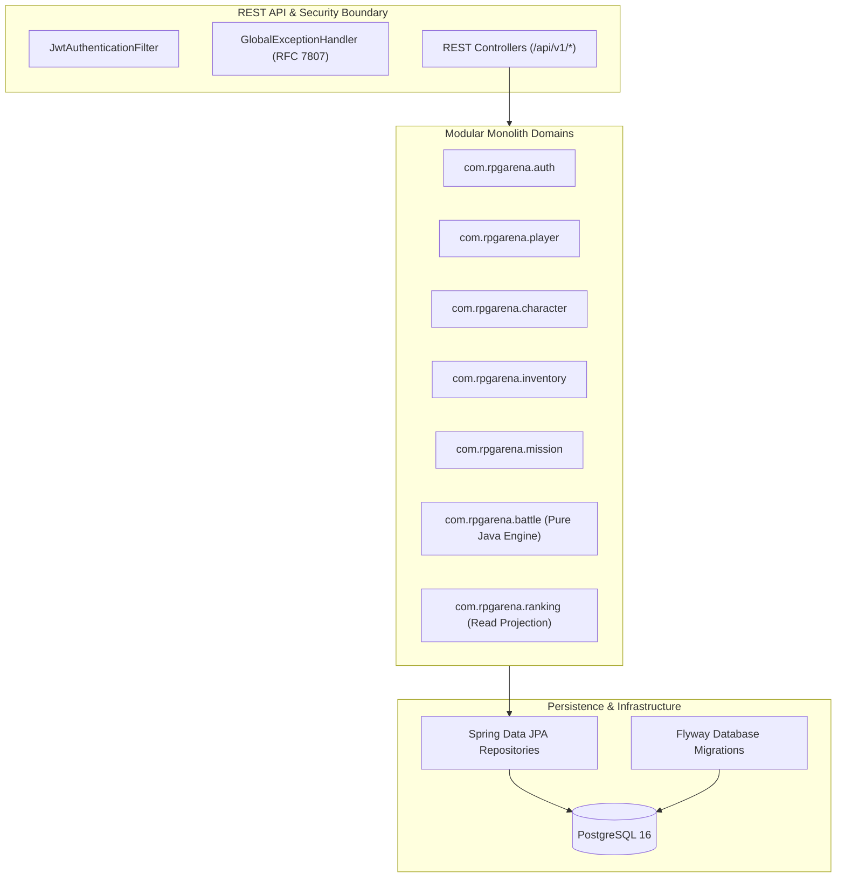
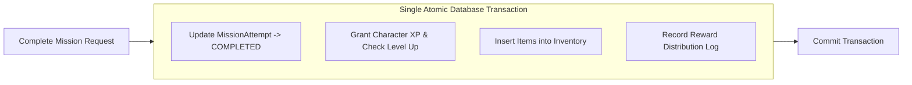

# Software Architecture Guide — RPG Arena

## 1. Architectural Philosophy: Modular Monolith

**RPG Arena** is intentionally architected as a **Modular Monolith** in Java 21 and Spring Boot 3. 

Rather than adopting premature distributed microservices complexity (network latency, distributed transactions, service discovery, eventual consistency failures), the system maintains strict logical boundaries within a single deployable artifact.



---

## 2. Package Structure by Feature Module

Each module encapsulates its responsibilities following clean architecture principles:

```text
com.rpgarena/
├── auth/                 # Identity, credentials, JWT token generation & filters
├── player/               # Player account management & profile use cases
├── character/            # Character aggregate, leveling formulas, attribute modifiers
├── inventory/            # Item aggregate, equipment slot management, inventory transactions
├── mission/              # Quest catalog, attempt state machine, idempotent reward engine
├── battle/               # Turn-based combat engine (Pure Java), action handlers, concurrency
├── ranking/              # Read-optimized leaderboard projections & queries
└── shared/               # Domain primitives, common exceptions, Result types, validation
```

### Module Internal Structure

```text
com.rpgarena.<module>/
├── api/                  # REST Controllers, DTOs, request validation schemas
├── application/          # Use cases, application services, transactional orchestrators
├── domain/               # Pure Java domain models, entities, state machines, domain exceptions
└── infrastructure/       # JPA entities, Spring Data repositories, external adapters
```

---

## 3. Pure Java Domain Layer Separation

A fundamental rule of this codebase is that **core domain logic is framework-agnostic**.

- **Combat Engine (`battle.domain`):** Damage formulas, hit checks, skill cooldown decrements, and status effects are computed entirely using pure Java classes with no Spring annotations (`@Component`, `@Service`, `@Autowired`, etc.).
- **Character Progression (`character.domain`):** XP threshold calculation and stat gain curves are modeled as immutable pure Java value objects and domain entities.
- **Benefits:** Fast unit tests (running in milliseconds without Spring context startup), high maintainability, and total decoupling from infrastructure.

---

## 4. Concurrency Control & Optimistic Locking

When multiple concurrent requests attempt to execute an action in the same battle or mutate the same inventory, the system enforces **Optimistic Locking**:

```mermaid
sequenceDiagram
    autonumber
    actor PlayerA as Player / Client 1
    actor PlayerB as Player / Client 2 (Concurrent)
    participant API as Battle API
    participant DB as PostgreSQL

    PlayerA->>API: POST /battles/42/actions (version=3)
    PlayerB->>API: POST /battles/42/actions (version=3)
    
    Note over API,DB: Player A's transaction commits first
    API->>DB: UPDATE battle SET version=4, ... WHERE id=42 AND version=3
    DB-->>API: 1 row updated (SUCCESS)
    API-->>PlayerA: 200 OK (Turn resolved, new state)

    Note over API,DB: Player B's transaction attempts update
    API->>DB: UPDATE battle SET version=4, ... WHERE id=42 AND version=3
    DB-->>API: 0 rows updated (OptimisticLockingFailureException)
    API-->>PlayerB: 409 Conflict (Concurrent action detected; please refresh state)
```

---

## 5. Security & Ownership Authorization (BOLA Prevention)

To guard against **Broken Object-Level Authorization (OWASP API1:2023)**:

1. The client never passes `playerId` to authorize operations.
2. The `JwtAuthenticationFilter` extracts and verifies the claims, populating Spring's `SecurityContextHolder`.
3. Application use cases resolve the authenticated user ID directly:
   ```java
   UUID authenticatedPlayerId = SecurityUtils.getCurrentPlayerId();
   Character character = characterRepository.findByIdAndPlayerId(characterId, authenticatedPlayerId)
       .orElseThrow(() -> new ForbiddenAccessException("You do not own this character"));
   ```

---

## 6. Transactional Consistency & Idempotency

### Atomic Reward Distribution
Mission completion involves mutating mission state and granting items/XP to the character. Both operations occur within a single `@Transactional` boundary:



### Idempotency Keys
For potentially repeatable operations (such as processing rewards or submitting combat actions), the API supports an `Idempotency-Key` HTTP header. Re-submitting the same key returns the cached successful response without reapplying side effects.

---

## 7. Architecture Decision Records (ADRs)

Key architectural choices are formally documented in the [`docs/adr/`](../adr/) directory:
- `ADR-001`: Adoption of Modular Monolith over Microservices.
- `ADR-002`: Pure Java Combat Engine and Domain Isolation.
- `ADR-003`: JWT-Based Stateless Authentication and Ownership Verification.
- `ADR-004`: PostgreSQL Versioned Migrations via Flyway.
